# Serverless-Architecture-Auto-S3-Bucket-Cleanup-with-AWS-Lambda-and-Boto3
A Serverless method to clean up AWS S3 Bucket using AWS Lambda &amp; Boto 3


## Overview

**Objective:** Gain hands-on experience with **AWS** Lambda and Boto3 by building a function that automatically deletes files older than 30 days from an S3 bucket.

**What this project does:**

- Creates an S3 bucket containing a mix of older and newer files.
- Creates an **IAM** role that lets Lambda access S3.
- Deploys a Python Lambda function that lists every object in the bucket, deletes those older than the retention period, and logs the name of each deleted object.
- Manually invokes the function and verifies that only recent files remain.

**Services used:** Amazon S3, **AWS** Lambda, **AWS** **IAM**, Amazon CloudWatch Logs, Boto3 (**AWS** **SDK** for Python).

---

## Architecture


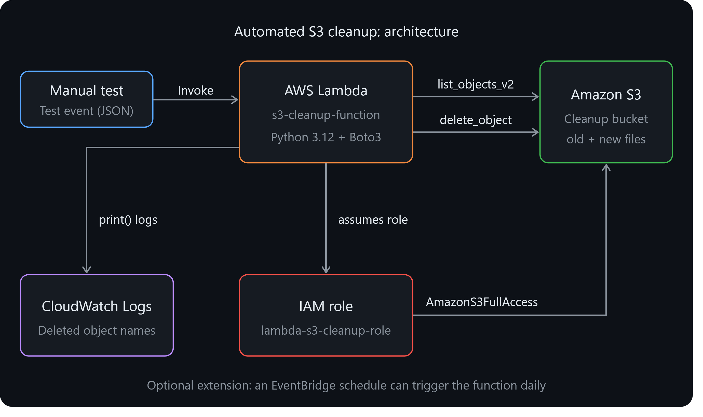

---

## Prerequisites

- An **AWS** account with access to the **AWS** Management Console
- Basic familiarity with Python
- A single **AWS** region used consistently for all resources (this project used `<**YOUR**-**REGION**>`, e.g. `ap-south-1`)

---

## Step 1: S3 Setup

### 1.1 Create the bucket

## Sign in to the AWS Console and select your region.

## Open **S3** and click **Create bucket**. ## Enter a globally unique bucket name: `<YOUR-BUCKET-NAME>`. ## Keep **Block all public access** enabled and **Versioning** disabled. ## Click **Create bucket**.

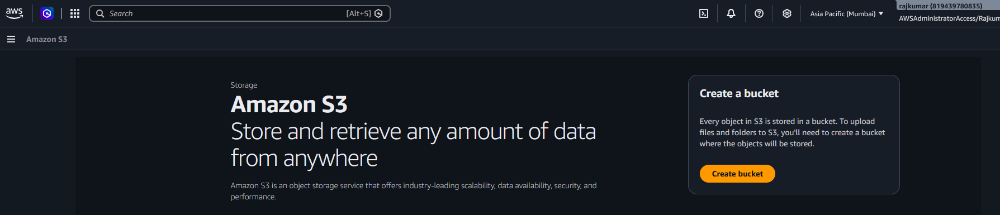

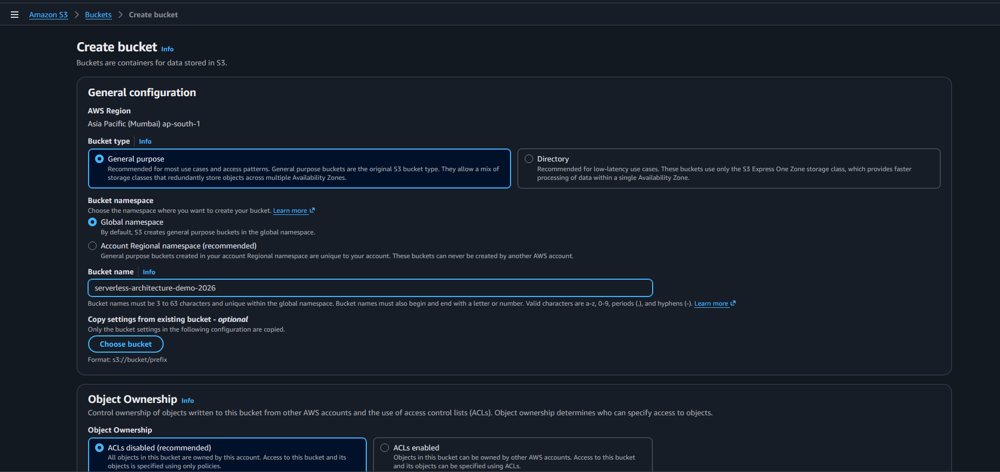

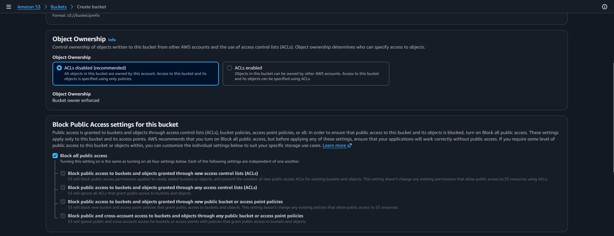

### 1.2 Upload the first batch of files (*old* files)

## Open the bucket and click **Upload** → **Add files**.

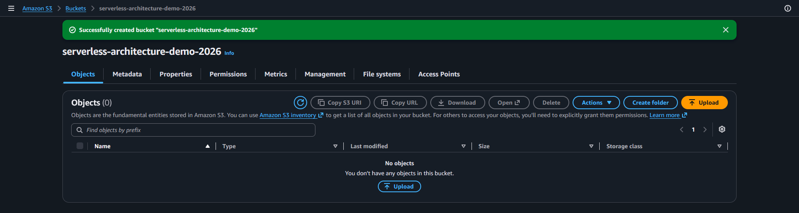

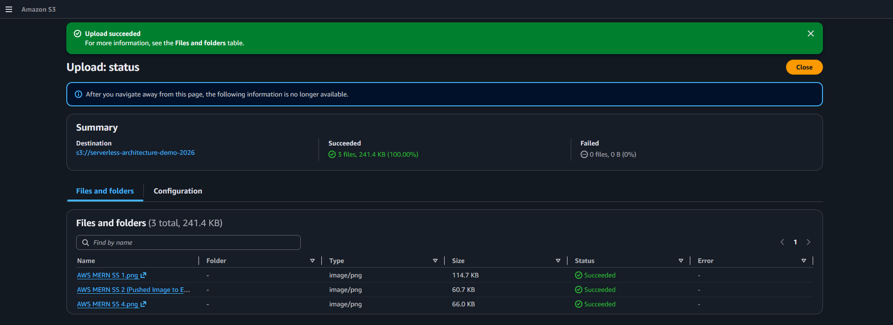

### 1.3 Upload the second batch of files (*new* files)

After waiting about 5 minutes, upload two more files: `new-file-1.txt` and `new-file-2.txt`. This creates two groups of objects with clearly different `Last modified` times.

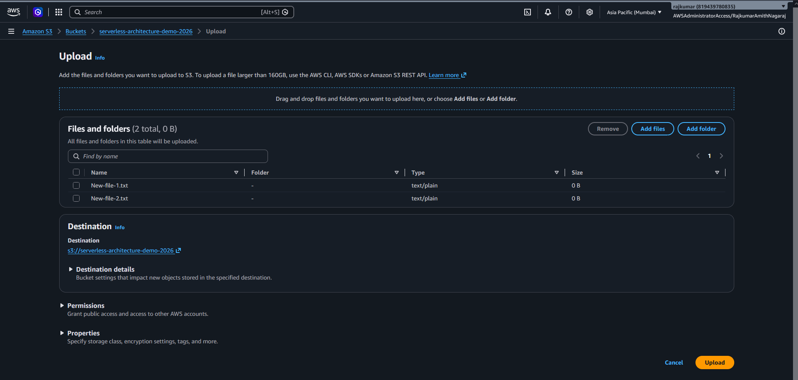

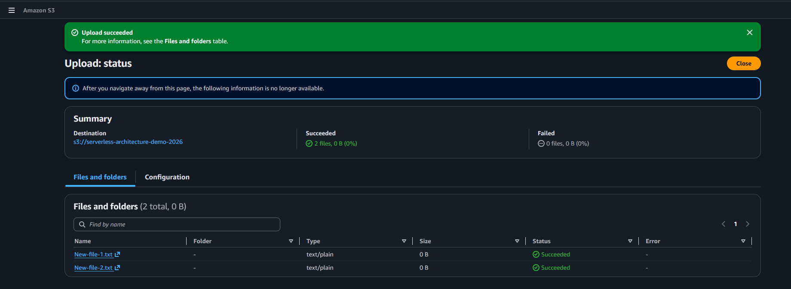

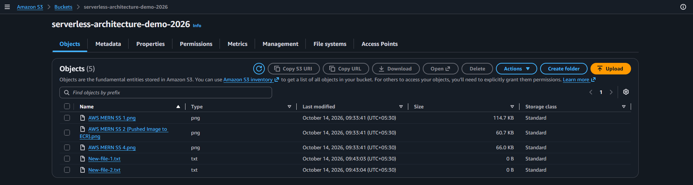

---

## Step 2: IAM Role for Lambda

## Open **IAM** → **Roles** → **Create role**.

2. **Trusted entity type:** **AWS** service. **Use case:** Lambda. Click **Next**.
## Search for and select the `AmazonS3FullAccess` policy.
## Click **Next**, name the role `lambda-s3-cleanup-role`, and click **Create role**.

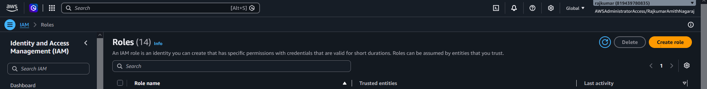

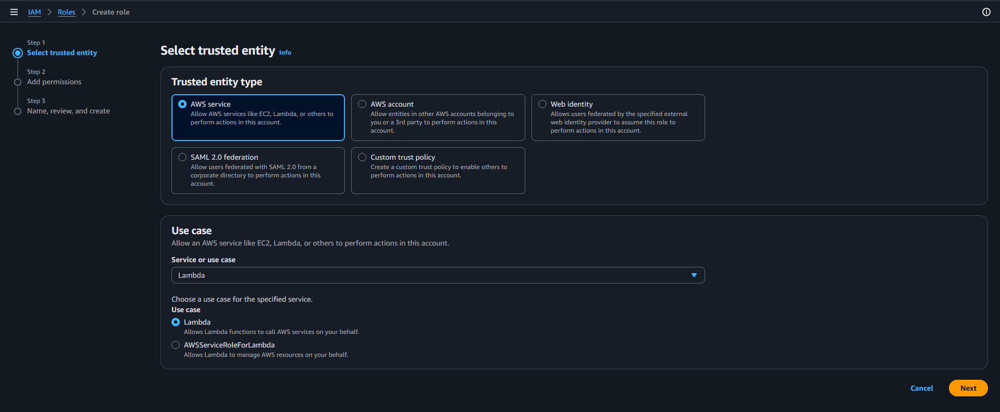

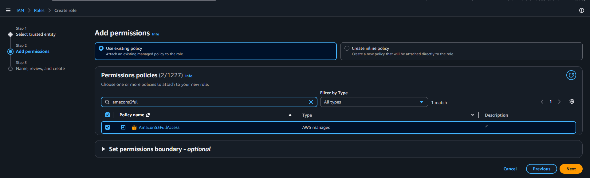

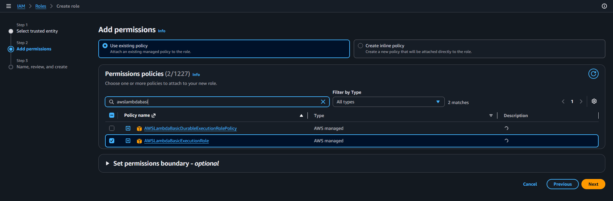

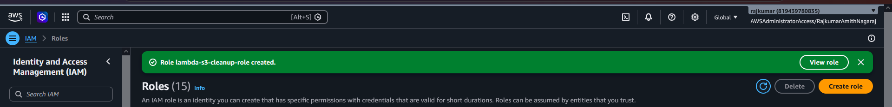

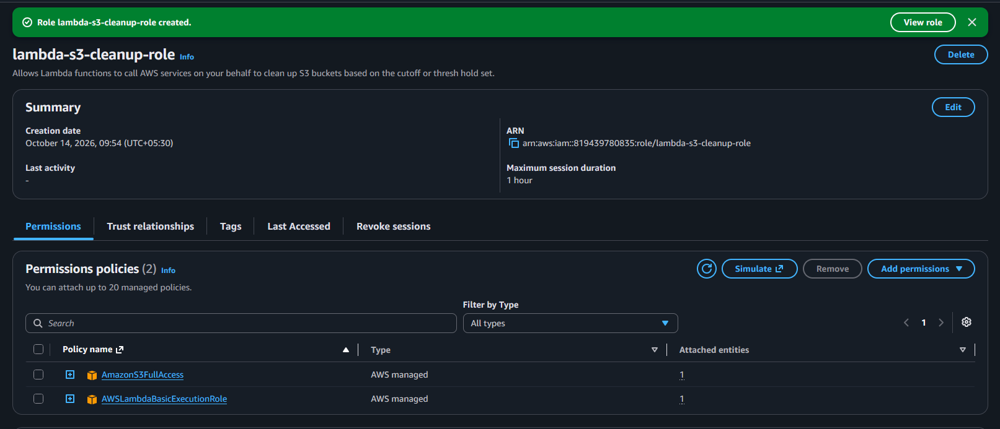

---

## Step 3: Create the Lambda Function

### 3.1 Create the function

## Open **Lambda** → **Create function** → **Author from scratch**.

2. **Function name:** `s3-cleanup-function`
3. **Runtime:** Python 3.12
4. **Execution role:** Use an existing role → `lambda-s3-cleanup-role`
## Click **Create function**.


### 3.2 Add the code

Paste the following into `lambda_function.py` and click **Deploy**:

```python import os from datetime import datetime, timedelta, timezone

import boto3

# 1. Initialize the S3 client

s3 = boto3.client(*s3*)

BUCKET_NAME = os.environ.get(*BUCKET_NAME*, *your-bucket-name*) DEFAULT_RETENTION_DAYS = int(os.environ.get(*RETENTION_DAYS*, *30*))

def lambda_handler(event, context):
    event = event or {}

    # Retention can be overridden from the test event (useful for demos).
    if *retention_minutes* in event:
    age = timedelta(minutes=int(event[*retention_minutes*]))
    else:
    age = timedelta(days=int(event.get(*retention_days*, DEFAULT_RETENTION_DAYS)))

    cutoff = datetime.now(timezone.utc) - age
    print(f*Bucket: {BUCKET_NAME}*)
    print(f"Deleting objects last modified before: {cutoff.isoformat()}")

    deleted = []
    kept = []

    # 2. List objects (paginator handles buckets with more than 1000 objects)
    paginator = s3.get_paginator(*list_objects_v2*)
    for page in paginator.paginate(Bucket=BUCKET_NAME):
    for obj in page.get(*Contents*, []):
    key = obj[*Key*]
    # 3. Delete objects older than the cutoff
    if obj[*LastModified*] < cutoff:
    s3.delete_object(Bucket=BUCKET_NAME, Key=key)
    deleted.append(key)
    # 4. Log the deleted object's name
    print(f*Deleted: {key}*)
    else:
    kept.append(key)

    print(f*Summary: {len(deleted)} deleted, {len(kept)} kept*)
    return {*deleted*: deleted, *kept*: kept}
```


### 3.3 Code explanation

| Step | Requirement | Implementation |
|------|-------------|----------------|
| 1 | Initialize a boto3 S3 client | `s3 = boto3.client(*s3*)` |
| 2 | List objects in the bucket | `list_objects_v2` via a paginator, so buckets with more than 1,000 objects are handled correctly |
| 3 | Delete objects older than 30 days | Compares each object's `LastModified` (UTC) with a computed cutoff and calls `delete_object` |
| 4 | Print deleted object names | `print(f*Deleted: {key}*)`, which appears in CloudWatch Logs |

**Design choices:**

- The retention period defaults to **30 days** (via the `RETENTION_DAYS` environment variable) and can be overridden per invocation through the test event.
- `datetime.now(timezone.utc)` is used because S3 timestamps are timezone-aware **UTC** values; mixing naive and aware datetimes would raise an error.
- The function returns lists of deleted and kept keys, which makes the result easy to verify.

### 3.4 Configure the environment variable

Under **Configuration** → **Environment variables**, add:

| Key | Value |
|-----|-------|
| `BUCKET_NAME` | `<YOUR-BUCKET-NAME>` |
| `RETENTION_DAYS` | `30` |


### 3.5 Increase the timeout

Under **Configuration** → **General configuration**, set **Timeout** to **30 seconds** (the 3-second default can be too short).


---

## Step 4: Manual Invocation and Verification

### 4.1 Demo run (short cutoff)

Create a test event named `demo-short-cutoff` with this **JSON** (adjust the number so the cutoff falls between the two batches of uploads):

```json { *retention_minutes*: 5 } ```


Click **Test**. The execution succeeded and returned the deleted and kept files:


### 4.2 CloudWatch logs

The logs confirm which objects were deleted:


### 4.3 Verify in S3 (AFTER cleanup)

After refreshing the bucket, only the newer files remain:


### 4.4 Default 30-day behaviour

Running the function with an empty event (`{}`) uses the 30-day default. Since no file is 30 days old yet, nothing is deleted:


---

## Note on Testing Old Files

The assignment suggests changing the system date or using old files to get objects older than 30 days. This does not work with S3: the `LastModified` timestamp is assigned by S3's servers at upload time, so neither the local machine's clock nor a file's original date affects it, and objects cannot be backdated.

To demonstrate the logic anyway, the function accepts an optional `retention_minutes` value in the event payload. The cutoff logic is identical for minutes or days. With no override, the function enforces the required **30-day** retention.

---

## Security Considerations

`AmazonS3FullAccess` grants far more access than this function needs. In a real deployment, replace it with a least-privilege policy scoped to the one bucket:

```json
{
    *Version*: ***2012**-10-17*,
    *Statement*: [
    {
    *Effect*: *Allow*,
    *Action*: *s3:ListBucket*,
    *Resource*: *arn:aws:s3:::<**YOUR**-**BUCKET**-**NAME**>*
    },
    {
    *Effect*: *Allow*,
    *Action*: *s3:DeleteObject*,
    *Resource*: *arn:aws:s3:::<**YOUR**-**BUCKET**-**NAME**>/**
    }
    ]
}
```

Other recommendations:

- Test against a non-production bucket first, since deletions are permanent on unversioned buckets.
- Consider an S3 **Lifecycle rule** for production use. It provides the same expiration natively, with no code to maintain. This project uses Lambda to practise Boto3 and serverless automation.

---

## Troubleshooting

| Problem | Likely cause | Fix |
|---------|--------------|-----|
| `AccessDenied` | Role lacks S3 permissions or is not attached to the function | Check **Configuration** → **Permissions** |
| `NoSuchBucket` | Typo in `BUCKET_NAME` or wrong region | Verify the name and region |
| `Task timed out` | Default 3-second timeout | Increase the timeout to 30 seconds |
| Nothing deleted | Cutoff is shorter than the files' age, or the files are too new | Check `Last modified` times and adjust `retention_minutes` |
| All files deleted | Cutoff is longer than every file's age | Use a shorter `retention_minutes` value |

---

## Cleanup

To avoid unnecessary charges, remove the resources after testing:

## Empty and delete the S3 bucket.

## Delete the Lambda function. ## Delete the IAM role `lambda-s3-cleanup-role`.

---

## Conclusion

This project automated S3 housekeeping using a Boto3-based Lambda function. It covered creating and configuring an S3 bucket, setting up an **IAM** execution role for Lambda, writing and deploying a Python function that lists and deletes objects by age, and verifying the result through both CloudWatch logs and the S3 console.

**Possible extensions:**

- Run the function daily with an **Amazon EventBridge** schedule.
- Restrict cleanup to a prefix (e.g. `logs/`) or file type.
- Add a dry-run mode that logs what would be deleted without deleting.
- Send a summary notification through **Amazon **SNS****.
- Replace the full-access policy with the least-privilege policy above.

---

## Repository Structure

```
.
├── **README**.md
├── lambda_function.py
└── screenshots/
    ├── 01-console-region.png
    ├── 02-create-bucket-form.png
    ├── ...
    └── 18-default-30-day-run.png
```
